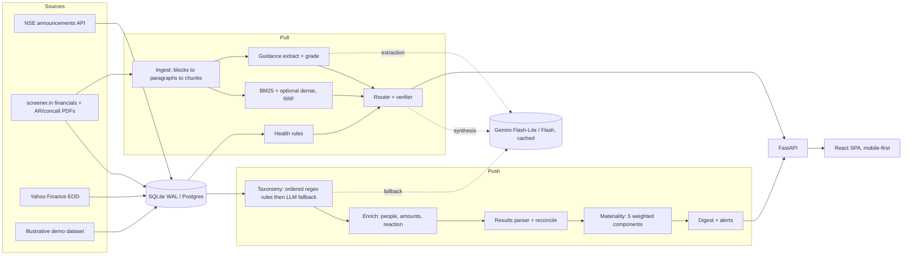

# FINN: a financial investment agent

FINN is a mobile-first prototype for the ENAM Holdings AI Engineer Build Challenge. It does two jobs for an investor:

- **Push.** It tells you what changed across a 20-stock NSE portfolio and why you should care. You get a windowed digest of exchange filings, ranked by an explainable materiality score, with routine paperwork collapsed. Quarterly results come with Revenue, EBITDA, PBT and PAT, QoQ and YoY, checked against the filing. A management change comes with the incoming person's background, read from the filing. You also get threshold alerts you set yourself.
- **Pull.** You can research any NSE ticker using only primary documents: annual reports, concall transcripts and reported financials. The main workflow is **Promise vs delivered**. FINN takes management's guidance from the last four calls, extracts it verbatim, and grades it in Python against what the company actually reported.

The core rule is that **the LLM never does arithmetic.** Every growth rate, margin, ratio and score is computed in code. When the documents don't support an answer, FINN says so: *"I could not verify this claim from the available primary documents."*

FINN runs with **zero API keys**. Every LLM feature has a deterministic fallback.

## Quick start

```bash
./run.sh local
```

Open <http://localhost:8000> and use the browser's phone view; the layout is designed mobile-first. This needs Python 3.11+ and Node 18+. The first run creates `backend/.venv`, builds the SPA and restores the prebuilt demo snapshot.

| Command | What it does |
|---|---|
| `./run.sh local` | Build and serve on `PORT` (default 8000) |
| `./run.sh test` | 31 pytest tests plus the 27-question evaluation |
| `./run.sh refresh [TICKERS]` | Pull live NSE, screener.in and Yahoo data for the portfolio, plus documents for the research names (default TRENT, HAL, PERSISTENT), then save the result as the seed snapshot |
| `./run.sh snapshot` | Rebuild the illustrative demo snapshot in `backend/seed` |
| `./run.sh deploy` | Push to GitHub and deploy to Render's free plan. It prompts for `RENDER_API_KEY` and an optional `GEMINI_API_KEY`, and never writes either to disk |

To turn on the language model, set `GEMINI_API_KEY` (free tier). See [.env.example](.env.example) for every variable.

> **About the data.** The live connectors are built to the documented endpoints. NSE, screener.in and Yahoo often block cloud IPs, so out of the box FINN runs on a **clearly labelled illustrative demo dataset**:
> - every row has `source="demo"`;
> - every generated PDF page carries the watermark *"ILLUSTRATIVE DEMO DOCUMENT - NOT A REAL COMPANY FILING - FIGURES ARE SYNTHETIC"*;
> - the UI shows a "Demo data" badge;
> - the people named in filings are fictional.
>
> A live refresh purges every demo row, so live and demo data never mix.

## How an investor uses it

| Moment | What FINN does | Why it's built that way |
|---|---|---|
| 8:30 am, on the phone | **Brief.** One assembled headline ("5 holdings need your attention") and a definition list of what changed. Then a **triage deck**: swipe right to pin, left when seen, tap for *Why it matters*. | The scarce skill is filtering. The deck forces a decision on each material item, and the 7 routine filings stay collapsed. |
| A card looks important | **Signal detail.** The *Why should I care?* panel separates fact (*confirmed from the filing*) from inference (*not a fact*) and lists what is still uncertain. It also shows the results card verified against the filing PDF, the people involved, the price around the filing, and **how FINN ranked it**. | Every rank can be explained. The five-segment **materiality strip** appears on every signal, and each segment is that component's contribution to the score. |
| "Did they deliver?" | **Promise vs delivered.** A hit rate, a dumbbell chart of guided range against reported value, revisions ("18–20% → 15–17%, Q4 FY26 to Q1 FY27 call"), and every statement quoted verbatim with speaker and page. | This analyses management rather than summarising them. Grading is pure Python with a 0.05 pp tolerance. |
| A follow-up question | **Ask FINN** is docked on every screen and already knows the company you're looking at. A router sends each question to the right engine and shows which one answered. | Numbers come from tables and narrative comes from cited passages. Each answer shows its evidence strength as factors, not as a fake probability. |
| "Tell me if something moves" | **Alerts.** Thresholds for volume and price moves, plus filing-type rules, all editable inline. | You decide what "unusual" means. Monitoring is end-of-day, and the app says so. |

## Architecture



- The backend is FastAPI, SQLAlchemy 2 on SQLite (WAL mode), `rank-bm25`, PyMuPDF, httpx and BeautifulSoup. It lives in `backend/finn`.
- The frontend is React 18, Vite, TypeScript, Tailwind 3, Recharts and lucide-react, in `frontend/src`. The font is Archivo variable, and its width axis carries the hierarchy.
- Deployment is one Docker image: a Node build stage, then a Python runtime that serves both the API and the SPA.

## API

| Route | Purpose |
|---|---|
| `GET /api/health` | Liveness |
| `GET /api/system/data-status` | Data mode, per-source status, counts, last EOD session, LLM stats, retrieval mode |
| `POST /api/system/demo-reset` | Restore the snapshot, or rebuild the demo |
| `GET /api/system/eval` | Latest evaluation results |
| `GET /api/meta/categories` | The 17 categories and their importance |
| `GET/POST/DELETE /api/portfolio[/{t}]` | Holdings with price snapshot, sparkline, 7-day signals and latest quarter |
| `GET /api/companies/search?q=` | Known companies, plus "any NSE symbol" |
| `GET /api/companies/{t}[/prices\|/financials\|/announcements]` | Company data |
| `GET /api/digest` | Windowed digest: `hours`, `start`, `end`, `ticker[]`, `sector`, `category[]`, `min_priority` |
| `GET /api/signals`, `GET /api/signals/{id}` | Paginated signals; full detail with price context and related filings |
| `POST /api/signals/{id}/triage` | `pin`, `dismiss` or `clear` |
| `POST /api/research/query` | `{ticker, question}`, routed, cited and verified |
| `GET /api/research/{t}[/documents\|/management-guidance\|/financial-health\|/bull-bear]` | Research views |
| `POST /api/research/{t}/ingest` | Background fetch of prices, fundamentals and documents (202) |
| `GET /api/documents/{id}/file` | The PDF, inline |
| `GET/POST/PATCH/DELETE /api/alerts[/{id}]`, `POST /api/alerts/seen` | Rules and history |
| `GET/PUT /api/settings/materiality` | Weights; saving re-scores everything |

## How it works

### Materiality: explainable ranking

The score is a weighted sum of five components:

`score = 0.25·Category + 0.25·Financial + 0.20·Deviation + 0.15·Relevance + 0.15·Novelty`

Each component is 0–100 and comes with a plain-English reason. The weights are editable in Settings, and saving re-scores every filing. The priority bands are critical ≥ 80, high ≥ 60, medium ≥ 35.

- **Category.** Base importance for each of 17 categories, with sub-type overrides. For example, a CFO change scores 92 and a company-secretary change 30. A rating downgrade scores 85 and a reaffirmation 20. A board-meeting notice scores 30.
- **Financial.** For results: `25 + max(|PAT YoY|, 1.5·|Rev YoY|)·2.5`. For anything with a ₹ amount, it is sized against annual revenue: `20 + 16·√(amount ÷ revenue × 100)·1.1`. That puts L&T's ₹5,000 Cr order at medium and KPIT's ₹950 Cr acquisition at critical.
- **Deviation.** The largest of three signals:
  - the results surprise (a z-score of PAT YoY against the last 8 quarters);
  - the price reaction in σ on the first session after the filing (filings after 16:00 count for the next day);
  - the volume reaction.

  It is capped at 25 for low-importance filings, so a postal-ballot notice can't take credit for an unrelated move.
- **Relevance.** 100 for a holding in a category you alert on, 75 for any other holding, 25 otherwise.
- **Novelty.** One minus the Jaccard similarity to the same company's filings of the **same sub-type** over 90 days. Scheduled filings are capped at 30. Duplicates (similarity > 0.85 within 2 days) are capped at a score of 10.

### Financial accuracy

- All maths lives in `services/numbers.py` and uses `Decimal` with `ROUND_HALF_UP`. A missing or zero denominator gives `N/A`, never an invented percentage. Growth uses `|base|`, so a narrowing loss reads as an improvement.
- Results are cross-checked. A deterministic SEBI-format parser reads the results PDF: it handles lakh, million and crore units, prefers the consolidated basis, and skips the "Profit before exceptional items" row. It derives EBITDA as PBT + finance cost + depreciation − other income, then reconciles against the structured financials within max(₹1 Cr, 2%). The result is **verified** or a **mismatch** that names the metric.
- Labels follow the Indian fiscal year (Q2 FY27 = Jul–Sep 2026). For banks and NBFCs, EBITDA is shown as N/A with the reason.

### Hallucination controls

1. **Routing.** Metric, multi-quarter, guidance and health questions never reach the LLM. They are answered from tables, with deterministic maths.
2. **Evidence-only prompts.** Narrative answers may use only numbered excerpts, must cite `[n]` on every factual sentence, forbid outside knowledge and arithmetic, and must use the exact refusal sentence when the evidence is missing.
3. **A verifier.** Every sentence's `[n]` must resolve to a real citation, and every number in the sentence must appear in the cited excerpts. If not, the sentence is tagged **unverified** in the UI. Tested against a mock that invents "Rs. 99,999 crore": the sentence is flagged.
4. **Verbatim guidance.** An LLM-extracted quote must be a substring of its chunk, or have at least 85% of it matched. Otherwise it is dropped, and the rules extractor takes over when nothing survives. Tested against a mock that invents a quote.
5. **Honest confidence.** Evidence strength combines retrieval relevance, coverage, numeric verification and source quality (0.6 for demo data). It is labelled *not a calibrated probability*.

### RAG

- **Ingestion.** PyMuPDF reads text blocks, then FINN strips running headers and furniture and groups lines into paragraphs. A heading must be a whole paragraph, and transcripts split on speaker turns. Chunks never cross a page, section or speaker boundary, and number-dense blocks become `table` chunks.
- **Retrieval.** BM25 over section plus text, with a tiny stemmer, a finance query expansion (revenue → sales, topline…) and the company's own name dropped from the query. Optional dense retrieval with fastembed (`FINN_ENABLE_DENSE=1`) is fused using Reciprocal Rank Fusion.
- **Sentence splitting** never breaks after "Rs.", "Mr." and similar abbreviations, so amounts survive intact.

### Promise vs delivered

1. **Extract** forward-looking statements from the last four transcripts. This uses rules, or Flash-Lite with a verbatim check.
   - Backward-looking sentences are skipped, so "revenue grew 16%" is not treated as guidance.
   - Targets are parsed with care: "30% to 35%" → 30–35, "at least 30%" → ≥ 30, "around 20%" → 19.5–20.5, "Rs. 1,000 crore" capex.
   - Horizons resolve to FY or quarter: "next quarter" said on the Q1 FY27 call → Q2 FY27, and "medium term" is long-dated.
2. **Grade** in Python against the annual row, or the sum of four quarters, or that quarter's YoY. The grade is exceeded, achieved, missed, pending (k/4 quarters reported), long-dated or not comparable (capex).
3. **Summarise** with a hit rate, revisions (same metric and horizon, a different target on a later call) and repeated misses. The interpretation is assembled deterministically. With a key, Flash rewrites it from the computed table only, in a neutral tone.

On the demo corpus, TITAN comes out at a 33% hit rate: it missed FY26 growth (16.0% vs ~20%) and missed Q1 FY27 growth (10.2% vs 14–16%), and its FY27 growth guidance was revised **down** from 18–20% to 15–17%.

### Financial health

This is a rule-based early warning, explicitly *not* a probability of default. It checks 4 numeric pillars over up to 6 years: profitability, leverage, cash quality and working capital. It also text-detects disclosed risks from the annual report (auditor qualification, contingent liabilities, related parties, pledging), each with its excerpt and page.

The overall label is **elevated** only when 2 or more pillars are elevated, so distress is never inferred from a single metric. For lenders the leverage and cash ratios are marked insufficient, with the reason.

### Generalisation

Nothing is hard-wired to the demo names. Any symbol matching `^[A-Z0-9&-]{1,20}$` works. "Fetch and index" calls yfinance for the profile and prices, then screener.in for financials and documents. It downloads the latest annual report and the last four transcripts (checking the `%PDF-` magic bytes), and maps each call month to the quarter it discusses. The same ingest, guidance and health pipeline then runs. A company with no documents gets the honest refusal, not a made-up answer.

### Cost discipline

- Rules run first. The LLM classifies a filing only when no rule matches.
- Model routing:
  - **Flash-Lite** handles the classification fallback, summaries, bios, the results-page fallback and guidance extraction.
  - **Flash** handles only narrative synthesis, the guidance interpretation and bull vs bear.
  - Pro is never used; it left the free tier.
- Models are resolved once per process from `/models`, skipping preview, image, tts and pro variants.
- Responses are cached in a separate SQLite file. A cache inside the main DB had deadlocked against open write transactions. Rerunning the mock test made 0 calls and got 6 cache hits.
- A 4.5 s throttle stays under the free tier's rate limit. 429s are retried with Retry-After. If the endpoint rejects JSON mode once, FINN stops trying it for the rest of the process.
- Exchange attachments are downloaded only for categories that need the PDF.

## Evaluation

`./run.sh test` runs `backend/eval/run_eval.py` over 27 questions: fact, guidance text, numeric, QoQ, guidance grading, trend and cross-document, insufficient evidence, and one contradiction. Results are in [backend/eval/results.json](backend/eval/results.json).

| Metric | Result | n |
|---|---|---|
| Route accuracy | 100% | 27 |
| Recall@5 (gold passage in the top 5) | 100% | 11 |
| Citation validity (excerpt exists in a stored chunk) | 100% | 15 |
| Numeric accuracy (vs independent recomputation) | 100% | 4 |
| Guidance grading counts | 100% | 4 |
| Insufficient-evidence handling | 100% | 3 |
| Unverified-sentence rate | 0% (extractive, no LLM) | — |
| Latency p50 / p95 | ~1 ms / ~3 ms | 27 |

**Caveat.** This runs on the illustrative demo corpus, so it validates the pipeline end to end: routing, retrieval, citation, maths and grading. It does **not** measure real-world accuracy on live filings. Building the eval surfaced three real router bugs, which are fixed: "revenue mix" was routed to the metric engine, "quick-commerce delivery" matched "deliver" as guidance, and the ratios table leaked into extractive answers.

## A 5-minute demo

1. **Brief (phone width).** "5 holdings need your attention": Results for DIXON and TITAN, M&A for KPITTECH, a management change at SUNPHARMA, a fund raise at BHARTIARTL, and unusual volume. The count line reads 18 filings: 3 critical, 2 high, 6 medium, 7 routine collapsed.
2. **Swipe the DIXON card right** to pin it. KPIT's ₹950 Cr acquisition comes up next, with a strip showing that it is 16.5% of annual revenue.
3. **Open SUNPHARMA, then "Why it matters".** Ritika Sharan *joins as* CFO, with her profile from the filing and a LinkedIn search link; Kunal Mehrotra *leaves*. All names are fictional demo data.
4. **Open DIXON.** Revenue is +38.0% YoY, and the card says *Verified against filing p.2, consolidated*. "How FINN ranked this" shows the scores 90, 100, 100, 100 and 70 with their reasons.
5. **Go to Research, then TITAN, then Promise vs delivered.** The hit rate is 33%, the dumbbell shows two red misses, the FY27 guidance was revised down, and every quote is verbatim with its page.
6. **Open the Health tab.** TITAN is **Elevated** in two pillars: 3-year CFO/PAT is 44%, and inventory days went from 205 to 262.
7. **Ask FINN about TITAN.**
   - "What was PAT growth YoY?" is answered by the deterministic engine.
   - "What are the key risks?" is extractive and cited.
   - Asking HAL "What are the key risks?" gives the refusal sentence, because no documents are indexed.
8. **Alerts.** Change the volume threshold to 3× and the history re-derives. **Settings**: move the Novelty slider, then Save and re-score.

## What's built, deviations and why

- **Built:** everything in the spec.
  - Push: taxonomy, materiality, results parser and reconciliation, management-change bios, digest, alerts and triage.
  - Pull: ingestion, hybrid retrieval, router plus verifier, promise vs delivered, health, overview and bull vs bear.
  - Delivery: live connectors, the demo dataset, the API, a 6-screen mobile-first SPA, tests, eval, Docker, Render and `run.sh`.
- **SQLite instead of Postgres/pgvector.** One file, zero setup, and the prebuilt snapshot is a single committed file. The code is Postgres-compatible: it uses dialect-aware upserts and takes `DATABASE_URL`.
- **fastembed is optional.** BM25 with query expansion reaches 100% Recall@5 on this corpus. Dense retrieval adds an ONNX model download, which isn't worth it for a free-tier container.
- **No shadcn.** About ten hand-built primitives keep the look intentional and the bundle smaller.
- **Four tabs:** Brief, Portfolio, Research, Alerts. Settings sits behind the gear icon.
- **No LinkedIn scraping.** LinkedIn's terms forbid it. SEBI LODR already requires a brief profile of an appointee in the filing itself, so FINN reads it from there and links to a LinkedIn people search.
- **Demo price seed.** The synthetic random walk's seed salt (`PRICE_SALT` in `demo.py`) was chosen so the planted scenario reads as designed. For example, L&T's +2.4% move against its own volatility keeps its order at medium.

### Known limitations

- **Live connectors not exercised here.** The NSE, screener.in and Yahoo connectors were not run against the real sites from this environment. They are built to the documented endpoints, with retries and per-source status reporting. Run `./run.sh refresh` from a residential connection to exercise them.
- **LLM tested on a mock only.** Model resolution, 429 retry, the JSON-mode fallback, invented-number flagging, invented-quote rejection and caching were all verified against a mock OpenAI-compatible server, not the real Gemini API.
- **Lender metrics.** NIM, GNPA and CAR aren't in the data source, so bank health is marked insufficient rather than guessed.
- **Segment guidance.** Guidance is graded on consolidated numbers, and segment-level guidance is not yet separated.
- **EOD only.** Alerts are not real-time, and the app says so.

### What's next

- An ingest worker on a schedule, with push notifications for critical items.
- BSE filings, deduplicated against NSE.
- Segment-level guidance and KPI tracking (volumes, store counts).
- Narrative-vs-numbers contradiction detection across calls.
- Lender-specific health rules from investor presentations.
- A per-user portfolio and alerts behind sign-in.
