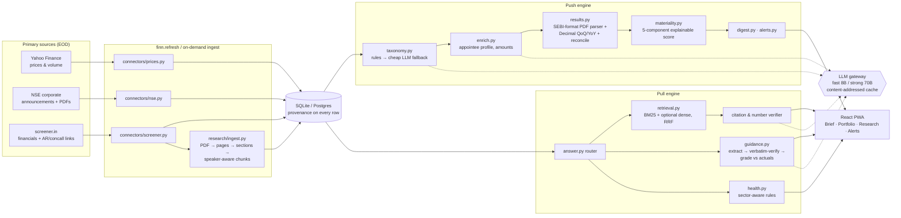

# FINN: Financial Investment Agent

A mobile-first investment-intelligence prototype for the ENAM Holdings AI Engineer Build Challenge.

FINN watches a 20-stock NSE portfolio, ranks every exchange filing by an **explainable materiality score**, explains *why it matters* with evidence, and answers research questions **only from a company's own annual reports, concall transcripts and reported financials**. Its standout workflow is **Promise vs delivered**: management's guidance from the last four earnings calls, graded against what the company actually reported.

> **Data honesty.** The deployed demo runs on a clearly labelled **illustrative dataset**: synthetic figures and filings, fictional people, every row tagged `source=demo`, a "Demo data" badge on every screen, and a red watermark on every generated PDF page. Real data comes from `python -m finn.refresh` (Yahoo Finance, NSE, screener.in), run on a machine whose IP the exchanges don't block. The two never mix: a live refresh purges every demo row.

---

## 1. Try it

```bash
# backend (Python 3.11+)
cd backend
pip install -r requirements.txt
uvicorn finn.api.app:app --reload          # builds the demo dataset on first start → http://localhost:8000/docs

# frontend (Node 20+)
cd frontend
npm install
npm run dev                                # http://localhost:5173 (proxies /api to :8000)
```

**Deploy to Vercel** (frontend on the CDN, the FastAPI backend as one Python function, all on one URL):

```bash
cd finn                       # repo root, where vercel.json lives
npx vercel@latest login       # once; opens the browser
npx vercel@latest --prod      # accept the defaults; settings come from vercel.json
npx vercel@latest env add GROQ_API_KEY production   # optional, then redeploy with --prod
```

On Vercel the database lives in `/tmp`, copied from the prebuilt snapshot in `backend/seed/` on each cold start (~1 s). Triage swipes and alert edits therefore persist only while an instance is warm. That's fine for a demo; for persistence, point `DATABASE_URL` at a hosted Postgres. Live ingestion (`finn.refresh`) is meant to run on your own machine, because exchange sites block cloud IPs. After a live refresh, copy `backend/data/finn.db` (and `backend/data/docs/`) over `backend/seed/`, then redeploy, and the deployed app will show real data.

Other hosts: single-URL production build: `cd frontend && npm run build`, then start uvicorn. FastAPI serves `frontend/dist` itself.
The Docker image does both: `docker build -t finn . && docker run -p 8000:8000 finn`. `render.yaml` deploys it to Render's free tier.

**Optional:** set `GROQ_API_KEY` (free tier) to turn on LLM summaries, extraction and synthesis. Without a key, every feature still works through deterministic fallbacks. See `.env.example`.

**Real data:**

```bash
cd backend
python -m finn.refresh                          # prices (1y EOD) + 7 days of NSE filings + screener fundamentals
python -m finn.refresh --research TRENT HAL     # also download & index annual report + last 4 concall transcripts
python -m eval.run_eval                         # re-run the evaluation on whatever corpus is loaded
pytest -q                                       # 33 unit + API tests
```

Schedule `finn.refresh` after market close (for example cron at 18:30 IST) to drive the end-of-day push cycle.

---

## 2. The point of view: how an investor should use this

Most "AI for investors" products aggregate and add a chat box. FINN starts from the brief's actual scarce skill, **filtering**, and builds the interaction around triage:

| Moment | Interaction | Why |
|---|---|---|
| **Morning, on the phone** | **The Brief**: a one-line headline built from the data ("5 holdings need your attention") with a ticker index under it, then a **triage deck**. Swipe right to *pin*, left once *seen*, tap for *Why should I care?* Routine filings are collapsed into one line. | The job is inbox-zero for filings. A deck makes you decide on each material item, and the ranking means you can stop after three cards. |
| **"Why is this here?"** | Every card carries a **materiality strip**: the 0–100 score drawn as its five weighted contributions (category, financial size, unusualness, relevance to you, novelty). The detail page shows each component's rule and reason. | Trust comes from showing the ranking logic, not from asserting it. |
| **A signal raises a question** | The detail page ends with **questions worth asking**. Tapping one sends it to **Ask FINN**, already scoped to that company. | Push flows straight into pull. |
| **Digging in** | **Ask FINN** stays docked above the tab bar and follows whatever company you're looking at. Every answer shows **which engine answered it** (structured maths, guidance grading, health rules, or document retrieval), its citations (document, period, page, excerpt), and an evidence-strength breakdown. | The investor should always know whether a number was computed or read. |
| **Judging management** | **Promise vs delivered**: hit rate, revisions, a guided-range-vs-reported chart, and every statement quoted verbatim with speaker, page and grade. | This is analysing management rather than summarising them, which the brief values most. |

Desktop gets a sidebar and a list view by default; everything is designed at 390 px first.

---

## 3. Architecture



```
backend/finn
  api/app.py            FastAPI routes (thin): validation, pagination, structured errors, static SPA
  connectors/           prices (yfinance) · nse (announcements + attachments) · screener (tables + documents)
  services/             taxonomy · materiality · signals · results · enrich · market · digest · alerts · llm · pipeline · numbers
  research/             ingest · retrieval · answer (router + RAG + verifier) · guidance · health · periods
  demo.py               the illustrative dataset (planted scenarios; source="demo")
  refresh.py / seed.py  CLIs
backend/eval            questions.json (27 curated) + run_eval.py → results.json (shown in Settings)
backend/tests           pytest: arithmetic, classifier, scoring, parser, guidance grading, verifier, API
frontend/src            App shell · pages/{Brief, SignalDetail, Portfolio, Research, Alerts, Settings} · components/{Ask, ui}
```

### API (all JSON; OpenAPI at `/docs`)

| Method | Route | Purpose |
|---|---|---|
| GET | `/api/digest?hours=24\|start&end&ticker&sector&category&min_priority` | Windowed brief: headline, counts, ranked material items, collapsed routine, EOD moves |
| GET | `/api/signals?hours&priority&category&ticker&page&page_size` · `/api/signals/{id}` | Ranked feed (paginated) · full signal with score breakdown, *Why should I care?*, results card, people, price context |
| POST | `/api/signals/{id}/triage` | `pin` / `dismiss` / `clear` |
| GET/POST/DELETE | `/api/portfolio` · `/api/portfolio/{ticker}` | Holdings with EOD snapshot, sparkline, 7-day signal count |
| GET | `/api/companies/search?q=` · `/api/companies/{t}` · `/prices` · `/financials` · `/announcements` | Any NSE symbol is accepted |
| POST | `/api/research/query` `{ticker, question}` | Routed, cited answer + confidence factors + verification report |
| GET | `/api/research/{t}` · `/documents` · `/management-guidance` · `/financial-health` · `/bull-bear` | Research views |
| POST | `/api/research/{t}/ingest` | Fetch fundamentals + AR + last 4 transcripts for **any** ticker, then index |
| GET/POST/PATCH/DELETE | `/api/alerts` · `/api/alerts/{id}` | Threshold rules + history |
| GET/PUT | `/api/settings/materiality` | Weights (normalised, re-scores everything) |
| GET | `/api/system/data-status` · `/api/system/eval` · POST `/api/system/demo-reset` | Source health, LLM usage, eval results |

---

## 4. How the important parts work

### Materiality engine
`Materiality = 0.25·Category + 0.25·Financial impact + 0.20·Deviation + 0.15·Relevance + 0.15·Novelty`, each 0–100 by a documented rule, never by an LLM:

* **Category:** base weight per category, adjusted by sub-type (a CEO/CFO change is 92 while a company-secretary change is 30; a rating *reaffirmation* is 20 while a *downgrade* is 85; a board-meeting *notice* is 30 while the results themselves are 90).
* **Financial impact:** for results, the YoY PAT/revenue swing. Otherwise the ₹ amount extracted from the filing as a share of annual revenue (√-scaled). So L&T's ₹2,500–5,000 Cr order ranks *medium* (≈2% of revenue) and KPIT's ₹950 Cr acquisition ranks *critical* (≈16%).
* **Deviation:** the larger of the results surprise vs the company's own last 8 quarters (z-score) and the EOD price/volume reaction vs its 20-day volatility. Capped for low-importance filings, so a postal-ballot notice doesn't take credit for an unrelated price move.
* **Relevance:** portfolio membership, plus whether you have an alert on that category.
* **Novelty:** token similarity to the company's earlier filings of the *same sub-type*. Duplicates are capped at 10; scheduled paperwork is capped at 30.

Bands (critical ≥ 80, high ≥ 60, medium ≥ 35) are prototype defaults. Weights are editable in Settings, and everything is re-scored when they change.

### Financial accuracy
* The LLM never does arithmetic. Growth, margins, ratios and the materiality score all run in `numbers.py` (Python `Decimal`). A zero or missing base shows **N/A**, never an invented percentage.
* Results numbers come from **two independent sources that are reconciled**: the structured quarterly table, and the actual results PDF parsed by a deterministic SEBI-format row parser (current | preceding quarter | same quarter last year). That parser handles lakh/million/crore units, consolidated vs standalone, and EBITDA computed as PBT + finance cost + depreciation − other income. A disagreement above 2% is shown as **mismatch** with the likely cause. The cheap LLM reads the PDF only when the layout defeats the parser.
* Sector awareness: for lenders, EBITDA, D/E, interest cover, working capital and cash conversion are switched off with an explanation, never computed meaninglessly. Exceptional items and other-income-heavy profit get flagged.

### Hallucination controls
* **Router first.** Numeric questions never reach an LLM.
* **Grounded prompts.** The model sees only numbered excerpts, must cite `[n]`, must use the exact refusal sentence when the evidence is missing, and is told not to use outside knowledge.
* **Post-hoc verification.** Every sentence's `[n]` must point at a real excerpt, and every number in a sentence must appear in its cited excerpts; otherwise the sentence is tagged *unverified* in the UI.
* **Verbatim guidance.** An LLM-extracted guidance quote that isn't found (≥ 85% longest-match) in its source chunk is dropped. If all are dropped, the rules extractor runs instead.
* **Honest emptiness.** No documents, or no relevant evidence, returns *"I could not verify this claim from the available primary documents."*
* **Confidence.** Shown as factors (retrieval relevance, evidence coverage, numeric verification, source quality), explicitly *not* a probability.

Tested against a deliberately dishonest mock LLM: an invented "₹99,999 crore" was flagged unverified, and an invented guidance quote was rejected.

### RAG
PDFs are read as text blocks (paragraph boundaries survive). Repeated headers and footers are stripped, headings set the section, transcripts split on speaker turns, number-dense blocks are kept whole as `table` chunks, and chunks never cross a page, section or speaker boundary, so every citation has an exact page and speaker. Retrieval is BM25 with light stemming and finance query expansion ("debt" also searches "borrowings"), optional dense embeddings (fastembed/ONNX), and **Reciprocal Rank Fusion** (k = 60), with metadata filters (business questions search the annual report first).

### Promise vs delivered
1. Keyword-filter management turns (moderators and analysts excluded), extract forward-looking statements (cheap LLM, or rules), and verify each quote verbatim.
2. Classify each statement: metric; target band (`30% to 35%` → 30–35, `at least 15%` → ≥15, `around 20%` → 19.5–20.5); horizon (`FY27`, `Q1 FY27`, *next quarter* resolved from the call date, *medium term*); and commitment (explicit target, range, outlook or qualitative). Vague language is never turned into a number.
3. Compute the actual in Python: full-year or quarterly growth or margin, summing four quarters if the annual row isn't published yet.
4. Grade it (exceeded, achieved, missed, pending, long-dated, not comparable) and detect **revisions** (same metric and horizon, different target on a later call) and **repeated misses**.
5. The strong model, if configured, writes a 3–4 sentence neutral interpretation of the *computed table only*. Otherwise a deterministic summary is used.

### Generalising to unseen companies
Nothing is keyed to the demo set. `POST /api/research/{ticker}/ingest` (or the "Fetch and index" button) resolves any NSE symbol, pulls screener tables and document links, downloads the latest AR and last four transcripts, indexes them, and extracts guidance. The research views then work exactly as for the demo names. Unknown sector? It falls back to the generic rules and says which metrics it couldn't assess.

### Cost discipline
* Rules classify filings for free; the 8B model only sees what the rules leave unclassified (none in the demo set).
* NSE attachments are downloaded only for non-routine filings.
* One page, not the whole PDF, goes to the LLM for results extraction.
* The 70B model is used only for synthesis and interpretation.
* Every call is cached by `sha256(model + messages)` in a separate SQLite file, so re-runs and repeat questions cost nothing.
* The whole demo runs with **zero** API calls.

---

## 5. Evaluation (`python -m eval.run_eval`)

27 curated questions (facts, numeric YoY/QoQ, multi-quarter, guidance grading, cross-document health, contradictory evidence, and insufficient-evidence traps) run through the real code path.

| Metric | Result (demo corpus, LLM off) |
|---|---|
| Route accuracy | 100% (27) |
| Retrieval Recall@5 | 100% (11) |
| Citation validity (excerpt exists in a stored chunk) | 100% (27) |
| Numeric accuracy vs independent recomputation | 100% (4) |
| Guidance grading vs gold labels | 100% (4) |
| Insufficient evidence handled honestly | 100% (3) |
| Unverified-sentence rate | 0% |
| Latency p50 / p95 | ~6 / ~19 ms |

**Read these honestly:** the demo corpus is small and was written alongside the questions, so this validates the *pipeline*, not real-world accuracy. The harness exists so the same numbers can be re-measured after `finn.refresh --research …` on real filings. Results are also shown in Settings → Evaluation.

---

## 6. Five-minute demo script

1. **Brief (0:00–1:15).** Open on a phone. Read the headline and ticker index. Swipe the DIXON results card right (pin), then the KPIT M&A card left. Point at the materiality strip. Expand "7 routine filings" to show what was buried and why.
2. **Why should I care? (1:15–2:30).** Open DIXON. Walk through: confirmed facts vs labelled inference, the +8.7σ price reaction, the results table **verified against the PDF (p.2)**, and the score breakdown table. Then open SUNPHARMA: the incoming CFO's profile, read from the filing itself.
3. **Push → pull (2:30–3:30).** Tap "How does this quarter compare with what management guided last quarter?". Ask FINN opens scoped to the company, shows the route label, the answer, and citations with page and speaker.
4. **Promise vs delivered (3:30–4:30).** Research → TITAN → *Promise vs delivered*: 33% hit rate, FY27 growth revised down from 18–20% to 15–17%, repeated revenue misses, every quote verbatim with page. Contrast TRENT, which is outside the portfolio, to show ad-hoc research.
5. **Control (4:30–5:00).** Alerts: change the volume threshold from 2× to 1.5× and watch the history re-derive. Settings: move the materiality weights, show source status, the LLM tier split, and the eval panel.

---

## 7. What's built vs what's deliberately left out

**Built and tested:**
* Push: classification (17 categories plus sub-types), explainable scoring, windowed digest (24h / 3d / 7d / custom) with filters and routine collapse, results QoQ/YoY with PDF reconciliation, appointee bios, configurable price/volume/category alerts with history, and swipe triage.
* Pull: PDF ingestion, hybrid retrieval, a routed and cited Q&A with verification, business and financial snapshots, trajectory, sector-aware health, promise vs delivered, bull vs bear.
* Portfolio add/remove/search, the demo reset, and the evaluation harness.

**Deviations from the original spec, and why:**
* **SQLite, not Postgres + pgvector.** One file, zero setup, enough for a 20-name prototype. `DATABASE_URL` accepts Postgres; the only dialect-specific code (price upserts) handles both. Tables are created with `create_all`, not Alembic migrations.
* **fastembed (ONNX), not sentence-transformers.** Torch doesn't fit a free hosting tier. Dense retrieval is optional; BM25 + RRF is the default. There is no cross-encoder reranker.
* **Hand-built UI primitives instead of shadcn/ui.** Five small components didn't justify the dependency.
* **Four mobile tabs, not seven.** "Overview" *is* the Brief, the signal feed is the Brief's list view, and financial health lives inside each company's research.
* **No LinkedIn scraping.** It breaks LinkedIn's terms. SEBI LODR already requires a brief profile of the appointee *in the filing*, so FINN reads that and attaches a LinkedIn search link.

**Known limitations:**
* The live connectors (NSE, screener.in, yfinance) are written against those sites' public endpoints, but **could not be exercised against the live sites from the build environment** (blocked egress). Expect selector or endpoint tweaks on first real run, and the refresh reports per-source status rather than failing silently.
* The LLM paths were tested against a mock OpenAI-compatible server, not live Groq.
* Health checks for lenders need NIM, GNPA, CASA and CAR, which aren't in screener's standard tables.
* Segment-level guidance can't be graded yet.
* Monitoring is end-of-day by design; there is no real-time feed or push notifications.

**Next:**
* Scheduled refresh with web-push notifications for critical alerts.
* Segment tables from investor presentations, so segment guidance can be graded.
* A peer-comparison view with definition checks.
* Real-corpus evaluation with analyst-labelled gold answers.
* A per-user "what I care about" profile that learns from triage swipes and feeds the relevance weight.
